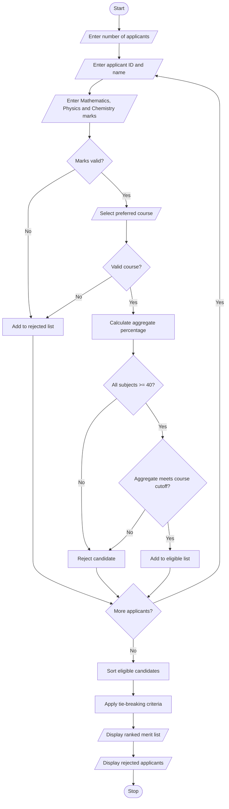

# University Admission Decision Engine – Python Program

## 1. Problem Statement

Develop a Python program to evaluate university admission applications based on subject eligibility, aggregate marks, course-specific minimum requirements, and tie-breaking criteria. The program should identify eligible candidates, rank them according to their performance, and generate a final merit list.


## 2. Algorithm

1. Start the program.
2. Enter the number of applicants.
3. Enter applicant name and application ID.
4. Enter Mathematics, Physics, and Chemistry marks.
5. Select the preferred course.
6. Check subject-wise eligibility.
7. Calculate aggregate percentage.
8. Compare aggregate with the course-specific threshold.
9. If eligible, add the candidate to the eligible list.
10. Sort eligible candidates by aggregate marks.
11. Apply tie-breaking criteria.
12. Display the ranked merit list.
13. Display rejected applicants.
14. Stop the program.

## 3. Flowchart



## 4. Sample Input

```
Enter number of applicants: 3

Applicant 1
Enter application ID: A101
Enter applicant name: Ravi
Enter Mathematics marks: 90
Enter Physics marks: 85
Enter Chemistry marks: 80
Select course: 1

Applicant 2
Enter application ID: A102
Enter applicant name: Sita
Enter Mathematics marks: 95
Enter Physics marks: 90
Enter Chemistry marks: 85
Select course: 1

Applicant 3
Enter application ID: A103
Enter applicant name: Kumar
Enter Mathematics marks: 35
Enter Physics marks: 70
Enter Chemistry marks: 65
Select course: 2
```

## 5. Sample Output

```
========== ADMISSION MERIT LIST ==========

Rank: 1
Application ID: A102
Name: Sita
Course: Computer Science
Aggregate: 90.0 %
Mathematics: 95.0
Physics: 90.0
Chemistry: 85.0

Rank: 2
Application ID: A101
Name: Ravi
Course: Computer Science
Aggregate: 85.0 %
Mathematics: 90.0
Physics: 85.0
Chemistry: 80.0

========== REJECTED APPLICANTS ==========

A103 - Kumar - Subject eligibility not satisfied

Admission Analysis Completed!
```
