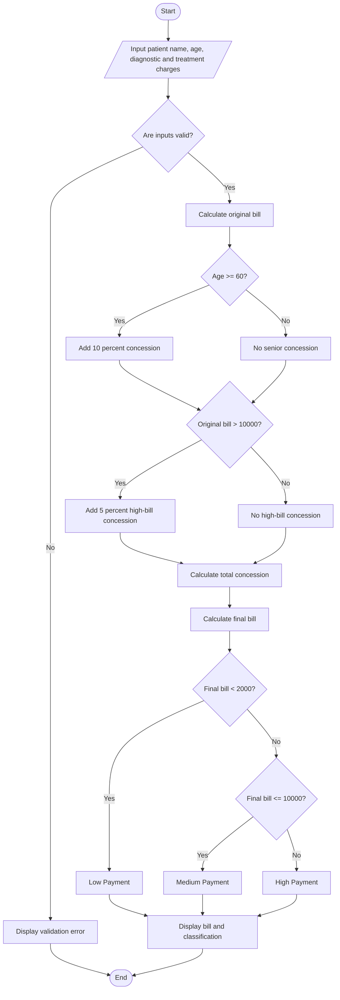

# Hospital Billing and Patient Classification System

This Python ABL project calculates hospital bills using consultation, diagnostic, and treatment charges. It applies conditional concessions, validates billing details, and classifies patients according to a sample payment policy.

## 1. Problem statement

Develop a Python program to calculate the total hospital bill for each patient by processing consultation fees, diagnostic charges, and treatment costs. The system must validate the entered billing information, apply concessions based on patient category and bill amount, calculate the final payable amount, and classify patients according to a predefined payment policy.


## 4. Algorithm

1. Start the program.
2. Input the patient's name, age, diagnostic charges, and treatment charges.
3. Validate the age and charges.
4. Set the consultation fee to ₹500.
5. Calculate the original bill by adding consultation, diagnostic, and treatment charges.
6. If the patient is a senior citizen (age 60 or above), apply a 10% concession.
7. If the original bill exceeds ₹10,000, apply an additional 5% concession.
8. Ensure the total concession does not exceed 15% of the original bill.
9. Subtract the concession from the original bill to calculate the final amount.
10. Classify the patient as Low, Medium, or High payment according to the final bill.
11. Display the bill details and patient classification.
12. Stop the program.

## 5. Flowchart



## 7. Sample input

```
Enter patient name: Ravi
Enter patient age: 65
Enter diagnostic charges: Rs. 3500
Enter treatment charges: Rs. 8000
```

## 8. Sample output

```
HOSPITAL BILLING SYSTEM

--- HOSPITAL BILL ---
Patient Name: Ravi
Patient Age: 65
Consultation Fee: Rs. 500.00
Diagnostic Charges: Rs. 3500.00
Treatment Charges: Rs. 8000.00
Original Bill: Rs. 12000.00
Concession: Rs. 1800.00
Final Bill: Rs. 10200.00
Patient Classification: High Payment
```

Calculation verification:

- Original bill = ₹500 + ₹3,500 + ₹8,000 = ₹12,000.
- Senior citizen concession = 10% of ₹12,000 = ₹1,200.
- High-bill concession = 5% of ₹12,000 = ₹600.
- Total concession = ₹1,200 + ₹600 = ₹1,800.
- Final bill = ₹12,000 − ₹1,800 = ₹10,200.

Since ₹10,200 is above ₹10,000, the patient is classified as High Payment.

