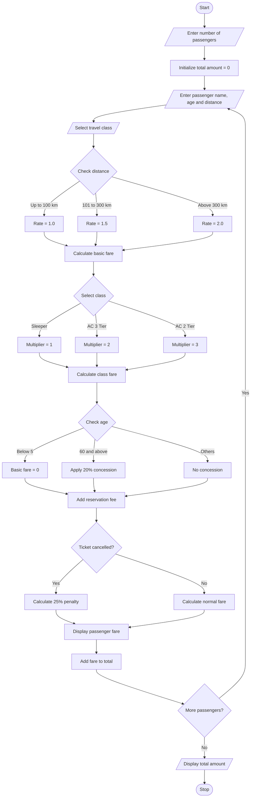

## Railway Fare and Reservation Calculator – Python Program
## 1. Problem Statement
Develop a Python program to calculate railway ticket fares for multiple passengers. The program should calculate fares based on distance travelled, travel class, age-based concessions, reservation fees, and cancellation penalties. Finally, display the total fare for all passengers.

## 2. Algorithm
1. Start the program.
2. Enter the number of passengers.
3. For each passenger:
   - Enter passenger name and age.
   - Enter journey distance.
   - Select travel class.
4. Calculate the basic fare based on distance.
5. Apply the selected class multiplier.
6. Check passenger age and apply concession.
7. Add reservation charges.
8. Ask whether the ticket is cancelled.
9. If cancelled, calculate the cancellation penalty.
10. Display passenger-wise fare details.
11. Calculate and display the total amount.
12. Stop.
## 3. Flowchart

## 4. Sample Input
Enter number of passengers: 2

Passenger 1
Enter passenger name: Ravi
Enter age: 25
Enter journey distance in km: 200
Select travel class: 1
Cancel ticket? (yes/no): no

Passenger 2
Enter passenger name: Sita
Enter age: 65
Enter journey distance in km: 200
Select travel class: 2
Cancel ticket? (yes/no): no

## 5. Sample Output
RAILWAY FARE AND RESERVATION CALCULATOR

Passenger Name: Ravi
Age: 25
Distance: 200 km
Travel Class: Sleeper
Basic Fare: Rs. 300
Reservation Fee: Rs. 40
Final Fare: Rs. 340

Passenger Name: Sita
Age: 65
Distance: 200 km
Travel Class: AC 3 Tier
Basic Fare: Rs. 480
Reservation Fee: Rs. 40
Final Fare: Rs. 520

------------------------------
Total Amount: Rs. 860
------------------------------
Thank you for using Railway Calculator!

fare.py, and save the Mermaid flowchart code separately for generating your flowchart image.
