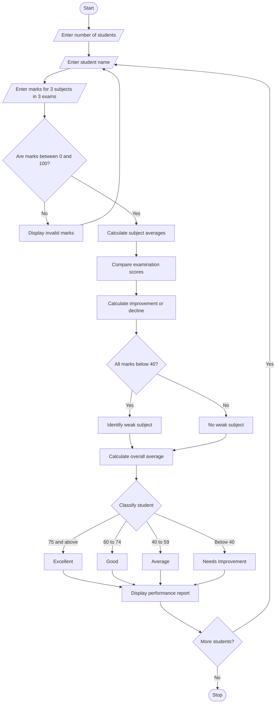

# Student Performance Trend Analysis – Python Program

## 1. Problem Statement

Develop a Python program to analyze student performance across multiple examinations. The program should compare assessment scores, calculate improvements and declines, identify consistently weak subjects, and classify students based on their overall performance.


## 4. Algorithm

1. Start the program.
2. Enter the number of students.
3. Enter the student name.
4. Enter marks for three subjects in three examinations.
5. Calculate the average marks for each subject.
6. Compare examination scores.
7. Calculate improvement or decline.
8. Identify consistently weak subjects.
9. Calculate the overall average.
10. Classify the student based on the average.
11. Display the performance report.
12. Repeat for all students.
13. Stop the program.

## 5. Flowchart


## 7. Sample Input

```
Enter number of students: 1

Enter student name: Ravi

Enter marks for Python
Exam 1: 50
Exam 2: 65
Exam 3: 80

Enter marks for Mathematics
Exam 1: 30
Exam 2: 35
Exam 3: 32

Enter marks for English
Exam 1: 60
Exam 2: 70
Exam 3: 75
```

## 8. Sample Output

```
STUDENT PERFORMANCE TREND ANALYSIS

----- PERFORMANCE REPORT -----
Student Name: Ravi

Subject: Python
Average: 65.0
Trend: Improved by 30.0

Subject: Mathematics
Average: 32.33
Trend: Improved by 2.0

Subject: English
Average: 68.33
Trend: Improved by 15.0

Overall Average: 55.22

Student Classification: Average

Consistently Weak Subjects: ['Mathematics']

Analysis Completed!
```

tudents based on their overall performance. This project demonstrates the use of loops, conditional statements, lists, and arithmetic operations in Python.
