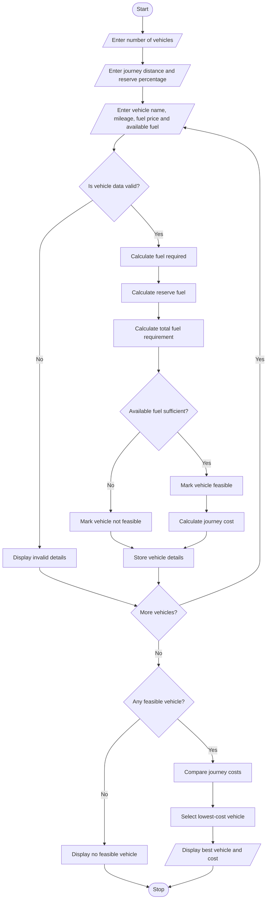

# 18. Fuel Consumption and Route Comparison – Python Program

## 1. Problem Statement

Develop a Python program to calculate fuel requirements and journey costs for multiple vehicles based on distance, mileage, fuel prices, and reserve fuel requirements. Compare different vehicles and identify the lowest-cost feasible option for the journey.


## 4. Algorithm

1. Start the program.
2. Enter the number of vehicles.
3. Enter journey distance.
4. Enter reserve fuel percentage.
5. For each vehicle:
   - Enter vehicle name.
   - Enter mileage.
   - Enter fuel price.
   - Enter available fuel.
6. Calculate fuel required.
7. Calculate reserve fuel.
8. Calculate total fuel requirement.
9. Check whether the vehicle is feasible.
10. Calculate journey cost for feasible vehicles.
11. Compare the journey costs.
12. Identify the lowest-cost feasible vehicle.
13. Display the comparison report.
14. Stop the program.

## 5. Flowchart


## 7. Sample Input

```
Enter number of vehicles: 3

Enter journey distance in km: 300
Enter reserve fuel percentage: 10

Vehicle 1
Enter vehicle name: Car A
Enter mileage (km/l): 15
Enter fuel price per litre: 105
Enter available fuel in litres: 25

Vehicle 2
Enter vehicle name: Car B
Enter mileage (km/l): 20
Enter fuel price per litre: 105
Enter available fuel in litres: 20

Vehicle 3
Enter vehicle name: Car C
Enter mileage (km/l): 12
Enter fuel price per litre: 105
Enter available fuel in litres: 35
```

## 8. Sample Output

```
----- VEHICLE COMPARISON REPORT -----

Vehicle: Car A
Fuel Required: 20.0 litres
Reserve Fuel: 2.0 litres
Total Fuel Needed: 22.0 litres
Journey Cost: Rs. 2100.0
Status: Feasible

Vehicle: Car B
Fuel Required: 15.0 litres
Reserve Fuel: 1.5 litres
Total Fuel Needed: 16.5 litres
Journey Cost: Rs. 1575.0
Status: Feasible

Vehicle: Car C
Fuel Required: 25.0 litres
Reserve Fuel: 2.5 litres
Total Fuel Needed: 27.5 litres
Journey Cost: Rs. 2625.0
Status: Feasible

----- BEST OPTION -----
Lowest Cost Vehicle: Car B
Minimum Journey Cost: Rs. 1575.0

Analysis Completed!
```

dentifies the lowest-cost feasible option. This project demonstrates the use of loops, conditional statements, lists, dictionaries, and functions in Python.
