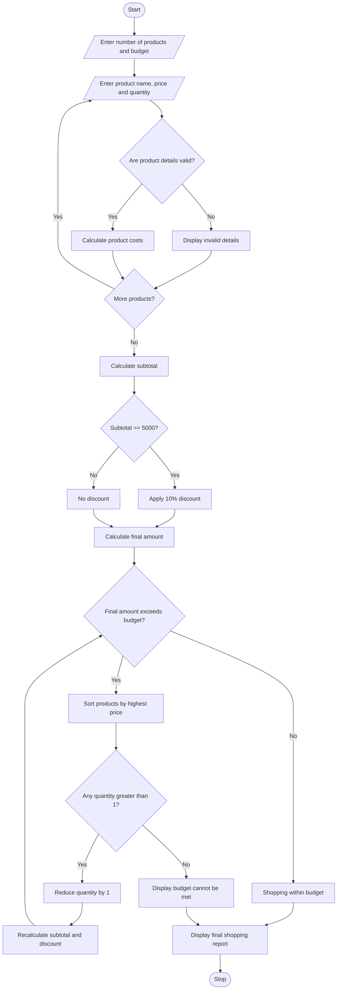

# 9. Multi-Product Shopping Budget Constraint – Python Program

## 1. Problem Statement

Develop a Python program to evaluate a shopping basket containing multiple products and quantities. The program should calculate the total cost, apply discount conditions, compare the total amount with a fixed budget, and determine which product quantities must be reduced to remain within the budget.


## 2. Algorithm

1. Start the program.
2. Enter the number of products.
3. Enter the shopping budget.
4. Enter product name, price, and quantity.
5. Calculate the cost of each product.
6. Calculate the subtotal.
7. Check discount eligibility.
8. Apply the discount if eligible.
9. Compare the final amount with the budget.
10. If the amount exceeds the budget:
    - Identify the most expensive products.
    - Reduce their quantities one by one.
    - Recalculate the total.
11. Display the final shopping list.
12. Display the remaining budget.
13. Stop the program.

## 3. Flowchart


## 4. Sample Input

```
Enter number of products: 3
Enter your shopping budget: 4000

Product 1
Enter product name: Shoes
Enter product price: 2500
Enter quantity: 1

Product 2
Enter product name: Bag
Enter product price: 1800
Enter quantity: 1

Product 3
Enter product name: Watch
Enter product price: 1500
Enter quantity: 1
```

## 5. Sample Output

```
MULTI-PRODUCT SHOPPING BUDGET CONSTRAINT

Original Shopping Total: 5800.0

----- FINAL SHOPPING REPORT -----

Product: Shoes
Quantity: 1
Price: 2500.0
Total: 2500.0

Product: Bag
Quantity: 1
Price: 1800.0
Total: 1800.0

Product: Watch
Quantity: 1
Price: 1500.0
Total: 1500.0

Subtotal: 5800.0
Discount: 580.0
Final Amount: 5220.0

Status: Budget Cannot Be Met
Minimum Amount Required: 5220.0

Shopping Analysis Completed!
```

Note: In this example, every product has quantity 1, so the program cannot reduce any quantity further. Therefore, it reports that the budget cannot be met.

